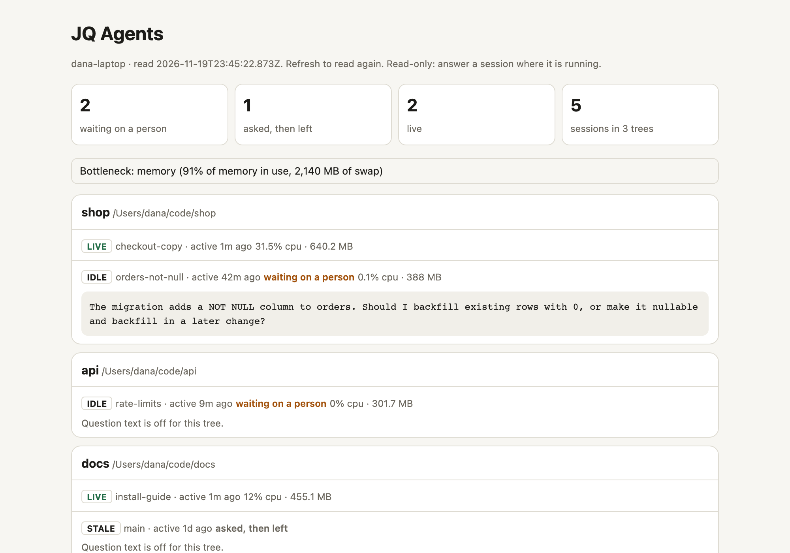

# JQ Agents

A local, read-only board of every Claude Code session on your machine: what each one is doing, and which are waiting on a person.

If you run several sessions at once, the cost is the ones that stopped to ask you something an hour ago in a window you forgot. This shows them on one page.



*The data in the picture is made up.*

## Run it

```sh
npx @point-seven-studio/jq-agents
```

Then open <http://127.0.0.1:4319>. Refresh to read again.

```sh
npx @point-seven-studio/jq-agents --json             # print one snapshot
npx @point-seven-studio/jq-agents --html board.html  # write the page to a file
npx @point-seven-studio/jq-agents --port 5000
```

Node 18 or later. No dependency.

## What it shows

Sessions are grouped by working tree (the git repository a session is in), because several sessions often share one.

- **State:** `live` (active in the last 15 minutes), `idle`, `stale`, or `dead` (no running process).
- **Waiting on a person:** the session ended its turn and is alive. "Asked, then left" is the same thing gone stale: an old unanswered question, counted separately so the headline number means "needs you now".
- **Branch** and time since the last activity.
- **CPU and memory** per session, and one line when the machine is short of something. When nothing is short it shows nothing.

## What it reads, and what it does not send

- It reads the tail of each session transcript under `~/.claude/projects`, a socket folder, and the process table.
- It is **read-only**. It never writes into a session, and there is no way to answer a session from the board. It writes two files of its own: its config, when you correct a label (see below), and a note in `~/.jq/running/` while the page is served (see Links to the other tools).
- **Question text is off by default.** The board says a session is waiting, not what it asked. To show the question for sessions in chosen folders:

  ```sh
  npx @point-seven-studio/jq-agents --questions ~/code/my-app,~/code/other
  ```

  The text is cut to 400 characters and strings shaped like secrets are removed. That removal is a pattern list, so it can miss one: only turn this on for folders where you would be content to read the session's last message on this screen.
- **Nothing leaves your machine** unless you pass one of two flags:
  - `--probe` times a TLS handshake to `api.anthropic.com` so the bottleneck line can name the network. Nothing is sent.
  - `--watch --exec CMD` hands each snapshot to a command of yours (below).

## Sending snapshots somewhere

For a team board or a history, run it as a relay and give it a command that stores the snapshot:

```sh
npx @point-seven-studio/jq-agents --watch --interval 60 --exec './store-snapshot.sh'
```

Every interval, your command receives one JSON snapshot on stdin (`machine`, `generated_at`, `sessions`, `host`, `bottleneck`). If the command fails, the relay says so each time. This package stores nothing and has no server; where snapshots go, and who may read them, is yours to decide. Question text only appears in a snapshot for folders you listed with `--questions`.

## As a library

```js
import { snapshot, totals, deriveAttention, computeBlockedEpisodes } from '@point-seven-studio/jq-agents'

const snap = await snapshot({ sample: false })
console.log(totals(snap.sessions))
```

`computeBlockedEpisodes` and `summarizeHistory` turn a log of attention changes into "how long were sessions blocked on a person". You keep the log.

## Limits

- **It depends on Claude Code internals.** The transcript files and the socket folder are not a public interface. A Claude Code release can change them; when that happens rows degrade (unknown state, no question text) until this package is updated.
- **macOS for the resource numbers.** Sampling uses `vm_stat`, `sysctl`, `iostat` and `nettop`. On Linux the session list works and those columns are blank.
- **Liveness is matched by working tree,** not by session. Two sessions in one repository are both marked alive if either is.
- It reads your own account's sessions only.

## Stopped without a check

When a session ends its turn, it has decided on its own that the work is done. The board says when nothing else looked:

- **stopped without running a check:** the turn edited code, and no test, lint, type-check or build command ran after the last edit.
- **stopped after a failed check:** the last such command after the last edit reported an error.

A session that checked its work, or edited no code, gets no label. In `--json` each session has `turn_check` (`checked`, `failed`, `unchecked`, `no-edits`, `unknown` or `dismissed`, and `null` while the session is still working) and `turn_check_via` (`tool` or `shell`).

### What counts as an edit

- The edit tools, on a file that is code or configuration. A note, a picture, or a file in scratch space is not counted.
- From 0.1.5, a shell command that writes a **named** code file: an in-place `sed` or `perl`, `mv`, `cp`, `rm`, `patch`, `tee`, `git apply|mv|rm`, a redirect into a file, or code handed to an interpreter that writes a file.

A shell command is easy to misread, so the rule leans toward not counting one. We ran a first version over 2,762 ended turns in our own transcripts and it labelled 710 of them, nearly all wrongly: 326 were `source x >/dev/null`. The rule that shipped labels 69 of the same turns. We did not review those 69 one by one, so some of them are wrong too.

### When a label is wrong

On the board, a labelled row has a **Why, and is it wrong?** link. It shows the command that was taken as the edit and what ran after it, and offers:

- **Count "..." as a check here:** for a project whose check is its own command, such as `make verify`.
- **"..." does not edit code here:** for a command that was misread as an edit.
- **Dismiss this one:** hides the label until that session moves again.
- **Never label this tree.**

Everything you have corrected is listed at the bottom of the board, each with a button to take it back.

Corrections are saved under the `turnCheck` key of `~/.jq/config.json` (or `--config FILE`). It is the only file of yours JQ Agents changes (the other is its own running note, under Links to the other tools), and other keys in it are left as they were. A save is accepted only from the page this process served: the request must name this server, come from this server's own page, and carry a token made when the process started. `--no-manage` serves the board with no forms at all. `--html`, `--json` and `--exec` never include the forms or the command text.

### Limits

- **"Checked" means a check ran, not that the work is right.** A check whose output is piped into another program can fail and still read as passed.
- **Missed edits:** a write whose target is held in a variable, and a formatter or a generator, which change files without naming them.
- **A check that a subagent ran is not counted.**
- It reads tool names, shell commands and the error flag of a result, on your machine. One word per session goes into a snapshot, and none of the command.

## Links to the other tools

The served page has a bar at the bottom with a link to each of the other JQ tools. A tool that is running on this machine is a link to the port it is really on. One that is not says "not running" and gives the command that starts it. The team board is a link when `~/.jq/config.json` holds a `"team"` line with its address, and says "not set up" otherwise.

How a page knows what is running, without a network call: while a tool serves its page it keeps a small note in `~/.jq/running/` (the tool, its port, its process id), and removes it when it stops. The other pages read those notes and ignore one whose process is gone. The bar is as of the last page load. A page written with `--html`, or shown inside JQ Deck, has no bar.

## Related tools

- [jq-deck](https://www.npmjs.com/package/@point-seven-studio/jq-deck): all of these on one local page, from one command.
- [jq-deck-server](https://www.npmjs.com/package/@point-seven-studio/jq-deck-server): the same view for a team, across machines.
- [jq-groundcrew](https://www.npmjs.com/package/@point-seven-studio/jq-groundcrew): a setup check for Claude Code.
- [jq-crosstalk](https://www.npmjs.com/package/@point-seven-studio/jq-crosstalk): a file mailbox between agent sessions.

Each one works alone. [Why we built them](https://www.hivejournal.com/blog/jq-tools-one-command).

For a team that wants the board across machines without running a server, there is a [waitlist for a hosted board](https://www.hivejournal.com/jq-deck#hosted).

## About

Made by [Point Seven Studio](https://www.hivejournal.com/point-seven-studio). Licence: Apache-2.0. Unofficial: not affiliated with or endorsed by Anthropic. "Claude" and "Claude Code" are Anthropic's names for their products.
