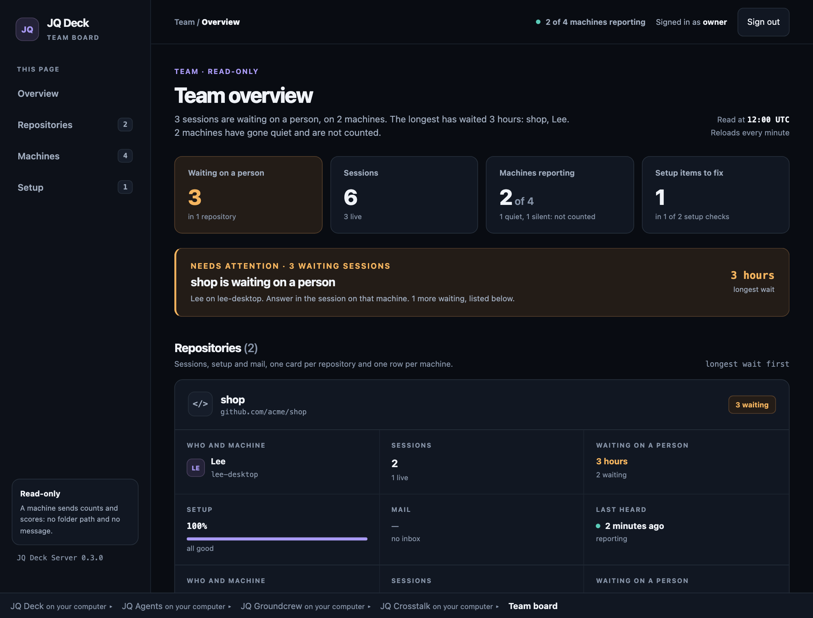

# JQ Deck Server

One page for a team: which Claude Code sessions are waiting on a person, on whose machine, and for how long.

Each machine runs [jq-deck](https://www.npmjs.com/package/@point-seven-studio/jq-deck) and reports counts and scores for the repositories it chooses. This server keeps the latest report from each machine and shows them together. You host it yourself, so your team's data stays on your own systems.



*The data in the picture is made up.*

## Hosted for you

Not available yet. Point Seven Studio runs one board, for its own team. Hosting one for another team needs things this server does not have: more than one team on a server, sign-in by account, history and alerts.

If you would rather not run a server, [join the waitlist](https://www.hivejournal.com/jq-deck#hosted). You get one email if hosting opens, and nothing else. This package stays open source either way.

## What a machine sends

Per repository: its name, its git remote (`host/owner/name`), how many sessions, how many are waiting on a person and since when, the setup score, and the unread mail count.

It does not send a folder path, any message, or any file name. The server drops every field it does not know, so a sender cannot put more on the board even by mistake. A machine reports only the repositories it lists.

**What a waiting session asked is sent only if that machine opts the folder in,** with `jq-deck --watch --send-questions ~/code/shop`. It is off by default. When on, the text is cut to 400 characters and strings shaped like secrets are removed by jq-agents before it leaves; that removal is a pattern list and can miss one. Opt a folder in only if you would be content for everyone who can see that repository on the board to read the session's last message. The board shows a question only while its machine is current, and only to viewers who may see that repository.

## Set it up

On the server (Node 18 or later, no dependency):

```sh
npm install -g @point-seven-studio/jq-deck-server
jq-deck-server init /var/lib/jq-deck
export JQ_DECK_SERVER_DIR=/var/lib/jq-deck

jq-deck-server add-machine dana-laptop --who "Dana"    # prints that machine's token, once
jq-deck-server add-viewer lee                           # prints Lee's token, once
jq-deck-server add-viewer contractor --repos shop,api   # sees those repositories only

jq-deck-server serve --host 0.0.0.0 --port 4320
```

Put HTTPS in front of it (a reverse proxy, or your platform's own). Off this machine, the sign-in cookie is marked `Secure`, so sign-in does not work over plain HTTP unless you pass `--plain-http`, which sends tokens in the clear.

On each machine that reports:

```sh
npm install -g @point-seven-studio/jq-deck @point-seven-studio/jq-deck-server
export JQ_DECK_TOKEN=jqm_...        # that machine's token
jq-deck --watch --repos shop,api --exec "jq-deck-server send --url https://deck.example.com"
```

`--repos` is required: it is the list of repositories that machine agrees to report. `--all-repos` reports every repository with a session.

A viewer opens the server's address and pastes their token into the sign-in page.

### As a container

```sh
docker build -f packages/deck-server/Dockerfile -t jq-deck-server .     # from the repository root
docker run -p 4320:4320 -v jq-deck-data:/data jq-deck-server
docker exec <container> jq-deck-server add-machine dana-laptop --who "Dana"
```

The data folder is `/data`. Mount a volume there, or a restart forgets every token. The port comes from `$PORT` when the platform sets one. `GET /healthz` answers `ok` for a health check.

## The page

- **The line at the top** says how many sessions are waiting on a person and which has waited longest.
- **Four totals:** sessions waiting on a person, sessions (and how many are live), machines reporting out of machines known, and setup items to fix. They add up what the machines reporting now sent. The server works out no score of its own.
- **An amber strip,** only while something waits: the repository that has waited longest, whose machine it is on, and for how long. Answer it in the session on that machine.
- **One card per repository,** with a row per machine: sessions, waiting, setup score, unread mail, and when the machine was last heard from. Where a machine opted in, what its waiting sessions asked is under its row. The same repository on two machines is one card when both have the same git remote.
- **Machines and Setup,** side by side below: when each machine was last heard from, and each setup check that was reported.
- **A machine not heard from for 5 minutes is not counted.** Its rows stay, greyed, marked "not current". After a day its rows are hidden and it is listed as silent. Old numbers never look current.
- **Unknown is never shown as zero.** No inbox, no setup check and no reported wait each show a dash with the reason beside it.
- The page reloads every minute. It is read-only: there is no way to answer a session from it. The links at the side jump to parts of the same page. It follows the reader's light or dark setting.

`GET /api/team` returns the same as JSON, with `Authorization: Bearer <viewer token>`.

## Who can do what

- **A machine token** can post that machine's report, and nothing else. It cannot read the board. A report is stored under the name the token belongs to, so one machine cannot report as another.
- **A viewer token** can read the board, and nothing else. With `--repos`, the viewer sees only those repositories; counts are worked out after that limit, and a machine with nothing they may see is not listed.
- `jq-deck-server remove NAME` stops a token working at once.
- Tokens are stored as SHA-256 hashes. A token is shown once, when it is made.

## What it stores

Plain files in the folder you chose: `config.json` (names and token hashes) and `reports/<machine>.json` (the latest report from each). There is no history. A backup is a copy of the folder. The server calls nothing.

## As a library

```js
import { handle, buildTeam, readReports, readConfig, sanitizeReport } from '@point-seven-studio/jq-deck-server'
```

`handle(request, context)` is the whole HTTP side as a function, for mounting inside a server you already run. `buildTeam(reports, now, viewer)` is the board as data.

## Limits

- **One process, one folder.** It is built for a team, not for many teams on one server. Run one per team.
- **No history.** It shows now, not how long sessions waited last week.
- **Access is by token.** There are no accounts, no single sign-on and no audit log. Anyone holding a viewer token can read what that viewer can.
- **No sign-in throttling.** Tokens are 256 random bits, so guessing is not practical, but put your own rate limit in front if your policy asks for one.
- **Mail is a count.** A file mailbox lives on one machine; this server does not carry messages.
- **A repository name is itself information.** That is why a machine must list what it reports.
- A git remote written with an SSH host alias (`github.com-work:acme/shop`) is sent as written, so that repository will not group with the same one cloned without the alias.

## Links to the other tools

The team page has a bar at the bottom naming the four local tools. A page served from a server cannot see a viewer's computer, so it does not say whether a tool is running there. Each name opens a short note with the address the tool would be at on the viewer's own machine (`http://127.0.0.1:` and its usual port) and the command that starts it. The page still loads nothing and runs no script.

## Related tools

- [jq-deck](https://www.npmjs.com/package/@point-seven-studio/jq-deck): all of these on one local page, from one command.
- [jq-agents](https://www.npmjs.com/package/@point-seven-studio/jq-agents): a board of every Claude Code session on your machine.
- [jq-groundcrew](https://www.npmjs.com/package/@point-seven-studio/jq-groundcrew): a setup check for Claude Code.
- [jq-crosstalk](https://www.npmjs.com/package/@point-seven-studio/jq-crosstalk): a file mailbox between agent sessions.

Each one works alone. [Why we built them](https://www.hivejournal.com/blog/jq-tools-one-command).

## About

Made by [Point Seven Studio](https://www.hivejournal.com/point-seven-studio). Licence: Apache-2.0. Unofficial: not affiliated with or endorsed by Anthropic. "Claude" and "Claude Code" are Anthropic's names for their products.
