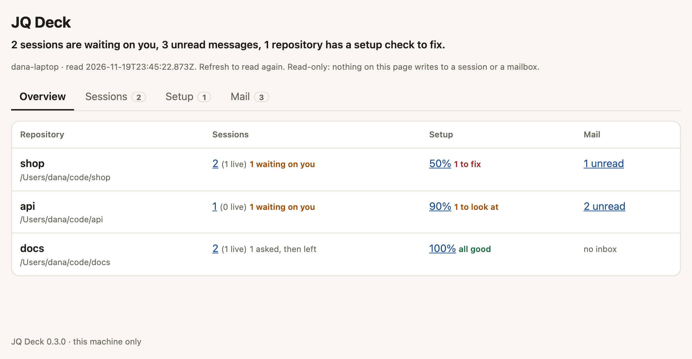

# JQ Deck

One command, one local page: every Claude Code session on your machine, the setup check for each repository, and the mailbox between sessions.

It is [jq-agents](https://www.npmjs.com/package/@point-seven-studio/jq-agents), [jq-groundcrew](https://www.npmjs.com/package/@point-seven-studio/jq-groundcrew) and [jq-crosstalk](https://www.npmjs.com/package/@point-seven-studio/jq-crosstalk) behind one page. It reads what they read. It writes one small note while its page runs, so the other JQ pages can link to it, and nothing else unless you run `jq-deck join`.



*The data in the picture is made up.*

## Run it

```sh
npx @point-seven-studio/jq-deck
```

Then open <http://127.0.0.1:4316>. Refresh to read again.

```sh
npx @point-seven-studio/jq-deck --mailbox ~/crosstalk   # show a mailbox
npx @point-seven-studio/jq-deck --json                  # print the overview
npx @point-seven-studio/jq-deck --port 5000
```

Node 18 or later. No dependency: the three tools are bundled in.

## What it shows

- **Overview.** One row per repository that has had a session in the last 3 days, plus the folder you ran it in: how many sessions and how many are waiting on you, the setup score, and unread mail. The line at the top says what needs you.
- **Sessions.** The jq-agents board.
- **Setup.** The jq-groundcrew report for each repository on the page. You do not pass a path: the repositories come from the sessions.
- **Mail.** The jq-crosstalk page: what is waiting, the board, and threads. With no mailbox, this tab shows the one command that makes one.

## Which mailbox, and which inbox belongs to which repository

The mailbox is the first of: `--mailbox`, `mailbox` in the config file, `$CROSSTALK_DIR`, the nearest folder above you holding a `.crosstalk` file.

An inbox is tied to a repository when it has the folder's name, or when it is the only inbox the folder's name starts with (`shop-v2` matches the inbox `shop`). When that guess is wrong or finds nothing, say so in the config file. An inbox tied to no repository on the page is listed under the table with its unread count; a repository with no inbox says "no inbox", never 0.

## The config file

Optional. `~/.jq/config.json`, or the file named by `--config` or `$JQ_DECK_CONFIG`:

```json
{
  "mailbox": "~/crosstalk",
  "names": { "billing": "~/code/payments-service" },
  "questions": ["~/code/shop"]
}
```

`names` maps an inbox to a repository folder. `questions` is the same as `--questions`. `"report": ["shop", "api"]` is the same as `--repos`.

## What it reads, and what it does not send

- It reads the tail of each session transcript under `~/.claude/projects` and the process table (jq-agents), the Claude Code settings and `CLAUDE.md` files of each repository listed (jq-groundcrew), and the message files in the mailbox (jq-crosstalk). Each tool's README lists exactly what it opens.
- Each repository on the Overview has an **Open folder in VS Code** link (`vscode://file/...`). It is a link on a page served to this machine, so the path goes nowhere. A session started from the editor is in that window.
- **`/?find=NAME`** marks the repository of that name. A team board links here that way, because it knows names and never paths. When no repository of that name has a session on this machine, the page says so.
- It is **read-only**. There is no way to answer a session or send mail from the page.
- **Question text is off by default.** The page says a session is waiting, not what it asked. `--questions DIR,DIR` turns it on for sessions under those folders.
- **Mail is shown in full** on the Mail tab, to anyone who can open the page on this machine.
- **Nothing about your sessions leaves your machine** unless you pass `--probe`, which times one connection to `api.anthropic.com` so the Sessions tab can name the network as a bottleneck, or `--watch --exec CMD`, which hands a report to a command of yours (below). Separately, the page asks npm once a day for the latest version number; see [The update check](#the-update-check).
- The server listens on `127.0.0.1` only, answers only requests addressed to `127.0.0.1` or `localhost`, refuses anything but GET, and may not be framed by another site. The Setup tab checks only repositories the page lists: a URL carries an id, never a path.

## Reporting to a team board

```sh
export JQ_DECK_TOKEN=jqm_...
npx @point-seven-studio/jq-deck --watch --repos shop,api --exec "jq-deck-server send --url https://deck.example.com"
```

Every interval (60 seconds, or `--interval`), your command receives one JSON report on stdin. [jq-deck-server](https://www.npmjs.com/package/@point-seven-studio/jq-deck-server) is a server that takes them; any command works.

- **You list what is reported.** `--repos` (or `report` in the config file) names the repositories, by folder name, remote or path. Nothing else is in the report, not even as a count. `--all-repos` reports every one. With neither, `--watch` refuses to start.
- **A report is counts and scores:** per repository its name, git remote, session counts, how long the longest-waiting session has waited, the setup score and the unread count. No folder path, no message, no file name.
- **Question text is not sent unless you opt a folder in:** `--send-questions ~/code/shop` (or `sendQuestions` in the config file) adds what each waiting session under that folder asked. `--questions` is about your own screen and sends nothing. The repository must also be one you report. The relay says at start whether question text is being sent.
- If the command fails, jq-deck says so each time.

### Keep reporting after a restart: `jq-deck join`

`--watch` reports only while its terminal stays open. `join` sets a machine up once:

```sh
npm install -g @point-seven-studio/jq-deck @point-seven-studio/jq-deck-server
export JQ_DECK_TOKEN=jqm_...
jq-deck join --url https://deck.example.com --repos shop,api
```

- **It sends one report first.** If the board refuses it (a wrong address or token), nothing is written.
- **It saves the token** in `~/.jq/deck-token`, readable by you only. Without `$JQ_DECK_TOKEN` it asks for the token in the terminal.
- **It writes the list you gave** as `report` in the config file, and a short script, `~/.jq/deck-report.sh`, that you can read. The script holds no token: it reads the file.
- **It installs a login job** that runs that script: a launchd job on macOS, a systemd user unit on Linux. On another system, or with `--no-service`, it installs none and tells you the command to keep running.
- **It says which named repositories have no session,** so a spelling slip shows at once.
- `--board ADDRESS` saves the board's own page as `team`, so the local pages link to it. `--send-questions` is as for `--watch`. There is no `--all-repos` here: a machine that reports by itself reports only what you named.
- `jq-deck leave` stops the job and removes the job file, the script and the token file. The token itself works until you remove the machine on the board.

**On macOS, a login job cannot read Desktop, Documents or Downloads.** A repository kept there is still reported, but its row may have no git remote and no setup score. `join` tells you when this applies and gives the two ways out: give `node` Full Disk Access in System Settings, or keep the reporter in a terminal.

It must be installed, not run through `npx`: the login job has to find it after a restart. It needs `jq-deck-server` installed too, which is what sends each report; `jq-deck` itself sends no report: its one outbound call is the update check, which a login job never makes.

## Copy buttons

Wherever a page shows a command to run, there is a **Copy** button beside it: in the bar at the foot of the page, and on the command that makes a mailbox, and on the pages it shows from the other tools.

That button is the one script the page runs. It copies the command beside the button you pressed and does nothing else: it reads no other part of the page and makes no request. Each page carries the same script, and the `jq-agents` page names it by its hash in a content policy. Where the script cannot run, the buttons stay hidden and the command can be selected by hand.

## The update check

When you start JQ Deck in a terminal to open its page, it asks npm once a day whether a newer version exists. If there is one, it prints one line and shows "Update" in the bar at the foot of the page, with the command to run. It installs nothing.

- **What is sent:** one request to `https://registry.npmjs.org/@point-seven-studio/jq-deck/latest`. It carries nothing about your machine, your project or a session. npm sees the package's name and your network address, as it does when you install.
- **When:** only when a person starts the page in a terminal. Never for `--json`, `--watch`, `join` or `leave`, never from a login job, never in CI.
- **How often:** at most once a day. The answer is kept in `~/.jq/update-check.json`.
- **If npm cannot be reached,** nothing happens and nothing is said. The page does not wait for it.
- **To turn it off:** `--no-update-check`, or `JQ_NO_UPDATE_CHECK=1`, or `"updateCheck": false` in `~/.jq/config.json`.

Each build fails if the command holds a second outbound call, or if this one points anywhere else.

## As a library

```js
import { collectOverview } from '@point-seven-studio/jq-deck'

const overview = await collectOverview({ mailbox: process.env.CROSSTALK_DIR ?? null, cwd: process.cwd() })
console.log(overview.headline)
```

## Limits

- **One machine.** The page shows your own account's sessions on this machine. For a view across a team's machines, report to [jq-deck-server](https://www.npmjs.com/package/@point-seven-studio/jq-deck-server).
- Everything each tool lists as a limit applies here: jq-agents depends on Claude Code internals and samples resources on macOS only; a mailbox has no access control.
- Every page load reads again. With many repositories the Overview runs the setup check on each, which takes a moment.

## Links to the other tools

The served page has a bar at the bottom with a link to each of the other JQ tools. A tool that is running on this machine is a link to the port it is really on. One that is not says "not running" and gives the command that starts it. The team board is a link when `~/.jq/config.json` holds a `"team"` line with its address, and says "not set up" otherwise.

How a page knows what is running, without a network call: while a tool serves its page it keeps a small note in `~/.jq/running/` (the tool, its port, its process id), and removes it when it stops. The other pages read those notes and ignore one whose process is gone. The bar is as of the last page load. A page written with `--html`, or shown inside JQ Deck, has no bar.

## Related tools

- [jq-deck-server](https://www.npmjs.com/package/@point-seven-studio/jq-deck-server): the same view for a team, across machines.
- [jq-agents](https://www.npmjs.com/package/@point-seven-studio/jq-agents): a board of every Claude Code session on your machine.
- [jq-groundcrew](https://www.npmjs.com/package/@point-seven-studio/jq-groundcrew): a setup check for Claude Code.
- [jq-crosstalk](https://www.npmjs.com/package/@point-seven-studio/jq-crosstalk): a file mailbox between agent sessions.

Each one works alone. [Why we built them](https://www.hivejournal.com/blog/jq-tools-one-command).

For a team that wants the board across machines without running a server, there is a [waitlist for a hosted board](https://www.hivejournal.com/jq-deck#hosted).

## About

Made by [Point Seven Studio](https://www.hivejournal.com/point-seven-studio). Licence: Apache-2.0. Unofficial: not affiliated with or endorsed by Anthropic. "Claude" and "Claude Code" are Anthropic's names for their products.
