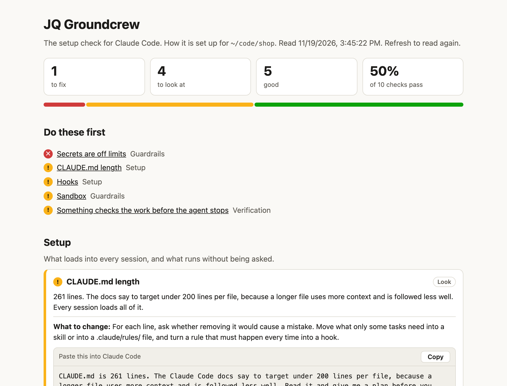

# JQ Groundcrew

The setup check for Claude Code.

Groundcrew reads how Claude Code is set up for a project and shows you what to fix. Each fix comes with a prompt you can copy and paste into Claude Code.

It runs on your machine. It sends nothing about your project anywhere. When you open its page it asks npm once a day for the latest version number, and you can [turn that off](#the-update-check).



*The data in the picture is made up.*

## Run it

In the folder of a project:

```sh
npx @point-seven-studio/jq-groundcrew
```

Then open <http://127.0.0.1:4317>. Refresh the page to check again after a change.

```sh
npx @point-seven-studio/jq-groundcrew path/to/project    # check another folder
npx @point-seven-studio/jq-groundcrew --html report.html # write the page to a file
npx @point-seven-studio/jq-groundcrew --json             # print the report
npx @point-seven-studio/jq-groundcrew --port 5000        # serve on another port
```

It needs Node 18 or later. It has no dependency.

## In CI

From version 0.1.1, `--fail-on fail` exits with code 1 when any check fails. `--fail-on warn` also counts a warning. The report still prints to stdout, and each counted check is named on stderr.

```sh
npx @point-seven-studio/jq-groundcrew@0.1.1 --json --fail-on fail
```

Pin the version, so a new check cannot fail your build overnight. Running it only when the setup changes (`CLAUDE.md`, `.claude/`, `.env*`) is enough.

Not every check means something in CI. A fresh clone has no `.env` file, because those are ignored by git, so the secrets check passes there whether or not a rule protects them. Run that one on a developer's machine. In CI the useful checks are the ones about files in the repository: `CLAUDE.md` growing past its target, a hook being removed, and a rule that approves every command.

## As a library

From 0.1.2 the checks can be run from your own code:

```js
import { gather, runChecks, summarize } from '@point-seven-studio/jq-groundcrew'

const checks = runChecks(gather(process.cwd()).facts)
console.log(summarize(checks))
```

`boardSummary(checks)` returns only the score, the counts and each check's id, title and status: the part that is safe to send to a team board, because it names none of your files.

## What it checks

**Setup: what loads into every session, and what runs without being asked**

- The length of each `CLAUDE.md`, against the target in the Claude Code docs of under 200 lines per file.
- Whether the auto memory index is longer than the part that loads.
- Whether any hook is configured.
- Whether any command is pre-approved.
- Your skills, subagents, custom commands and MCP servers, as plain facts.

**Guardrails: what the agent may reach, and what stops it**

- Whether a deny rule keeps the agent from reading secret files such as `.env`. This fails only if such a file exists and no rule covers it.
- Whether an allow rule approves every shell command.
- The permission mode.
- Whether the sandbox is on.
- How many folders outside the project the agent can reach.
- How long session transcripts are kept.
- From 0.1.6: whether a command your instructions restrict has a permission rule behind it. See below.
- From 0.1.8: whether an MCP server that a package runner fetches at start (`npx`, `bunx`, `pnpm dlx`, `yarn dlx`, `uvx`, `pipx run`) names one exact version. `npx some-mcp` runs whatever that name points to that day, with the reach your agent has. This one is our suggestion; the docs do not ask for it.

**Verification: who checks the work when the agent says it is done**

- Whether the agent can run a test, lint, type-check or build command without asking.
- Whether a hook runs when the agent finishes. A Stop hook can send it back to keep working.
- Whether each subagent is limited to the tools its job needs.
- From 0.1.8: whether a run with no person present sets a limit. It looks for `claude -p` and the GitHub action in workflows, package scripts and shell scripts, and for `--max-turns` or `--max-budget-usd` on each. The docs say of `--max-turns`: "No limit by default."

Each check links the page of Anthropic's Claude Code documentation it rests on. Advice that is ours, and not the docs', says "our suggestion".

## The harness, layer by layer

From 0.1.5 the page also sorts the same checks into six layers of an agent's harness, which is everything around the model:

| Layer | What it is | Checks today |
|---|---|---|
| Guides | What steers the agent before it works | Instruction file length, skills, custom commands |
| Sensors | What checks the work | Hooks, and whether the agent can run your checks |
| Loop | What sends the agent back when the work is not done, and what stops it going round | The Stop hook, and a limit on runs with no person present |
| Memory | What carries over between sessions | The auto memory index |
| Permissions | What the agent may and may not do | Secrets, blanket approvals, permission mode, sandbox, reach, subagent tools, rules written in the instructions |
| Observability | What a person can see of what the agent did | Transcript retention, as a fact |

Each row on the page also says what Groundcrew does **not** check in that layer, so a row of passes is not read as "covered". Memory and observability have one check each. In `--json` the rows are under `layers`, and each check carries its `layer`.

## OWASP tags

From 0.1.8, a check that bears plainly on an entry of the [OWASP Top 10 for LLM Applications 2025](https://genai.owasp.org/llm-top-10/) names it, on the page and as `risks` in `--json`:

| Entry | Checks |
|---|---|
| LLM02:2025 Sensitive Information Disclosure | The deny rule for secret files |
| LLM03:2025 Supply Chain | MCP servers with no exact version |
| LLM06:2025 Excessive Agency | Blanket approvals, permission mode, sandbox, reach, rules written in the instructions, subagent tools |
| LLM10:2025 Unbounded Consumption | A limit on runs with no person present |

The other six entries have no check here. Groundcrew looks at how Claude Code is set up on one project. It does not look at training data, a model, a retrieval store or an application's own prompts.

**A tag is our reading, not OWASP's, and a pass is not protection.** A pass means one setting is in place. This is not a security review and not a certification. The entry names are copied from the OWASP project's own files; a list from memory or from a shared graphic is easy to get wrong.

## Rules written in the instructions

A line in `CLAUDE.md` such as "never run `git reset --hard`" is advice. The Claude Code docs say "Permission rules are enforced by Claude Code, not by the model", and that instructions "shape what Claude tries to do, but they don't change these rules".

From 0.1.6 Groundcrew reads `CLAUDE.md`, `CLAUDE.local.md`, `AGENTS.md` and the files under `.claude/rules/` for commands they say never to run, or to ask about first, and compares them with your permission rules:

| The instructions say | Groundcrew asks you to look when |
|---|---|
| Never run a command | No deny rule covers it |
| Ask before running a command | An allow rule, or a permission mode that does not prompt, lets it run unasked |

An ask-first command that no rule names is not flagged, because Claude Code prompts for it by default. The check does say how many commands rest on that prompt alone, since one "don't ask again" removes it.

Limits:

- **It reads words, not meaning.** It finds a command only when the line writes it out, as in `git push`. "Never push to main" names no command and is not found.
- **It can be wrong about a line**, so the result is "look", never "fix", and the prompt it gives asks Claude Code to confirm each line before proposing a rule.
- **It finds, and does not write.** The rules are yours to add.

The layer names follow the "guides and sensors" way of describing an agent harness that several engineering teams have written about. The grouping of checks into them is ours.

## What it reads, and what it does not

It reads:

- the Claude Code settings files (user, project, local and managed);
- `CLAUDE.md` files, to count their lines;
- the names of your skills, subagents, commands and MCP servers;
- for each MCP server, the package a runner fetches it as, and nothing else of its entry: no other argument and no environment value, since either can hold a key;
- workflow files, `package.json`, `Makefile`, `justfile` and shell scripts in the project root, `scripts/`, `bin/` and `.claude/scripts/`, for two patterns only (`claude -p` and the GitHub action). Only the file and line of a match are kept;
- the names of files that usually hold secrets, to tell you whether a rule protects them.

It never opens a secrets file. It never reads a session transcript. The page lists every file it read.

The page has two small scripts, and both only copy: one puts a suggested prompt on your clipboard when you press its Copy button, and one does the same for a command in the bar at the foot of the page. The page itself loads nothing from the network.

## The prompts

A suggested prompt asks Claude Code to show its plan or its diff before it changes a file. Read that before you approve it. Groundcrew itself changes nothing.

## The update check

When you start JQ Groundcrew in a terminal to open its page, it asks npm once a day whether a newer version exists. If there is one, it prints one line and shows "Update" in the bar at the foot of the page, with the command to run. It installs nothing.

- **What is sent:** one request to `https://registry.npmjs.org/@point-seven-studio/jq-groundcrew/latest`. It carries nothing about your machine, your project or a session. npm sees the package's name and your network address, as it does when you install.
- **When:** only when a person starts the page in a terminal. Never for `--json` or `--html`, never from a login job, never in CI.
- **How often:** at most once a day. The answer is kept in `~/.jq/update-check.json`.
- **If npm cannot be reached,** nothing happens and nothing is said. The page does not wait for it.
- **To turn it off:** `--no-update-check`, or `JQ_NO_UPDATE_CHECK=1`, or `"updateCheck": false` in `~/.jq/config.json`.

Each build fails if the command holds a second outbound call, or if this one points anywhere else.

## Limits

- It covers Claude Code only.
- It checks setup. It does not look at how a session went.
- The checks follow the Claude Code documentation as it stood on 2026-11-14 (the two checks added in 0.1.8: 2026-11-22). The documentation can change.
- The limit check finds a run with no person present only where it is written as `claude -p` or the GitHub action. One started by another tool, or by a program built on the SDK, is not seen.
- The version check knows six package runners. A server run from a container image is not looked at.

## Links to the other tools

The served page has a bar at the bottom with a link to each of the other JQ tools. A tool that is running on this machine is a link to the port it is really on. One that is not says "not running" and gives the command that starts it. The team board is a link when `~/.jq/config.json` holds a `"team"` line with its address, and says "not set up" otherwise.

How a page knows what is running, without a network call: while a tool serves its page it keeps a small note in `~/.jq/running/` (the tool, its port, its process id), and removes it when it stops. The other pages read those notes and ignore one whose process is gone. The bar is as of the last page load. A page written with `--html`, or shown inside JQ Deck, has no bar.

**A light on a team board.** When this machine has a team board's address saved (`"team"` in `~/.jq/config.json`), JQ Groundcrew answers one small image at `/jq-up.svg`, so that board can show whether JQ Groundcrew answered the viewer's browser. The image says nothing about the machine. With no team board saved, that address answers 404.

## Related tools

- [jq-deck](https://www.npmjs.com/package/@point-seven-studio/jq-deck): all of these on one local page, from one command.
- [jq-deck-server](https://www.npmjs.com/package/@point-seven-studio/jq-deck-server): the same view for a team, across machines.
- [jq-agents](https://www.npmjs.com/package/@point-seven-studio/jq-agents): a board of every Claude Code session on your machine.
- [jq-crosstalk](https://www.npmjs.com/package/@point-seven-studio/jq-crosstalk): a file mailbox between agent sessions.

Each one works alone. [Why we built them](https://www.hivejournal.com/blog/jq-tools-one-command).

For a team that wants the board across machines without running a server, there is a [waitlist for a hosted board](https://www.hivejournal.com/jq-deck#hosted).

## About

Made by [Point Seven Studio](https://www.hivejournal.com/point-seven-studio). Unofficial: not affiliated with or endorsed by Anthropic. "Claude" and "Claude Code" are Anthropic's names for their products.

Licence: Apache-2.0. See the LICENSE file.
